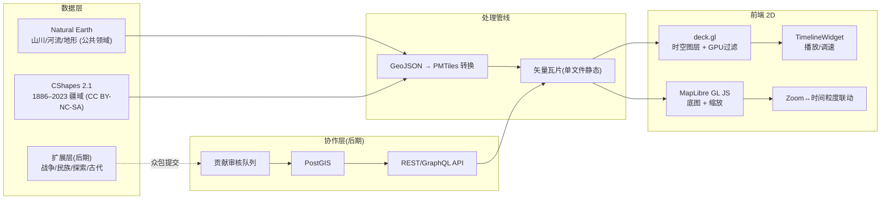

# 世界地理历史动态网站 — 需求与可行性分析报告

> 版本：v1.0（先期验证版）
> 日期：2026-10-23
> 定位：**公益 / 学术性**（非商业）
> 技术取向：**2D 平面地图**
> 数据策略：**从已有公开数据起步**，后期再扩展众包与进阶版本

---

## 0. 项目概述

本项目旨在构建一个**世界地理—历史时空动态可视化网站**：在一张世界地图上叠加山川河流等自然地理底图，并沿统一时间轴动态演示政权疆域变迁、战争扩张、民族交融、人类探索路径等历史信息；支持缩放查看区域级更细时间粒度，并预留开放接口供他人补充细化。

本次分析确认：**技术路线成熟、开源免费即可落地；核心难点在"数据"，尤其是 1886 年以前的全球政权疆域缺乏现成免费时空数据集。** 因此采用"先现代、后古代、用众包补古代"的分期策略，把开放接口从展示功能设计为数据生产引擎。

---

## 第一部分：需求报告

### 1.1 功能需求（FR）

| 编号 | 需求 | 说明 / 数据类型 |
|------|------|----------------|
| FR-1 | 世界地理底图 | 显示主要山川、河流、湖泊、地形阴影。数据源：Natural Earth（公共领域）。**中国边界须使用 China POV 版或 1:100 万公众版数据**（合规红线）。 |
| FR-2 | 历史时间轴变迁 | 四类时空图层，统一带时间有效性属性 `t_start / t_end`：<br>① 政权疆域（polygon）<br>② 战争 / 扩张（line + 时间区间）<br>③ 民族分布与迁徙（point / area + 时间）<br>④ 人类探索路径（trips 轨迹 + 时间动画） |
| FR-3 | 全图动态演示 | 时间滑块 + 播放 / 暂停 + 调速；同一时间阶段在全图缓慢播放。渲染采用 GPU 属性过滤，而非逐帧换文件，保证流畅。 |
| FR-4 | 本机先行 + 部署 | 先在本机以纯静态站跑通；部署考虑带宽 / 负载，采用矢量瓦片按需加载。 |
| FR-5 | 开放协作接口 | 提供接口让他人细化某阶段事件或补充详细信息；提交 → 审核 → 合并（类 Wikidata / Wikipedia 模型）。 |
| FR-6 | 区域放大细时间轴 | 地图缩放层级 ↔ 时间粒度联动：全球视图用世纪 / 朝代级时间步长，放大到区域用十年 / 年级。 |

### 1.2 非功能需求（NFR）

| 编号 | 类别 | 要求 |
|------|------|------|
| NFR-1 | 性能 | 全图播放流畅（≥ 30fps 交互）；首屏仅加载可视区域瓦片。 |
| NFR-2 | 合规 | 公益非商业；数据源许可证合规（CShapes CC BY-NC-SA 4.0 要求署名 + 非商用 + 相同方式共享）；中国边界正确。 |
| NFR-3 | 可维护性 | 数据与代码分离；图层可插拔；新数据接入成本低。 |
| NFR-4 | 可扩展性 | 预留众包接口与后期 3D / 古代数据扩展点。 |
| NFR-5 | 易用性 | 时间滑块、缩放、图层开关、点击查详情等基础交互直观。 |

### 1.3 数据需求（DR）

- **DR-1 自然地理底图**：河流中心线、湖泊、山峰高程点、地形阴影、海岸线。→ Natural Earth 10m / 50m（公共领域）。
- **DR-2 现代政权疆域（1886–2023）**：全球国界 + 殖民地，逐日精度。→ CShapes 2.1（CC BY-NC-SA）。
- **DR-3 扩展历史图层（后期）**：战争、民族、探索、古代疆域 → 无现成全球免费数据，需手工数字化 / 众包。

### 1.4 用户角色

| 角色 | 权限 |
|------|------|
| 访客 | 浏览、播放、缩放、查详情、搜索 |
| 贡献者（后期） | 提交某阶段事件 / 细节补充，进入审核队列 |
| 审核员（后期） | 审核贡献、合并或驳回 |
| 管理员 | 数据接入、图层管理、系统配置 |

---

## 第二部分：可行性分析报告

### 2.1 信息整合可行性

#### 2.1.1 可直接使用的公开数据

| 数据 | 覆盖范围 | 格式 | 授权 | 备注 |
|------|---------|------|------|------|
| Natural Earth | 山川 / 河流 / 湖泊 / 地形 / 现国界 | SHP / GeoJSON | 公共领域 ✅ | 中国边界用 **China POV 版**或官方公众版 |
| CShapes 2.1 | 全球国界 + 殖民地 1886–2023 | GeoJSON / CSV / SHP / SQL | **CC BY-NC-SA 4.0（非商用）** ⚠️ | 全球唯一免费历史边界集，逐日精度 |

#### 2.1.2 数据缺口（核心风险）

- **1886 年以前全球政权疆域**：**无免费、准确、全球、随时间变化的疆域数据集**。CShapes 仅覆盖至 1886；Euratlas（欧洲 0–2000 AD）、Centennia（欧洲 1000–2000）仅覆盖欧洲且收费。古埃及、汉唐、罗马、蒙古帝国等时段须自行建设。
- **民族迁徙 / 战争路径 / 探索路径**：全球无任何现成时空数据集，需人工整理并引用权威来源。
- **竞品参照 GeaCron**（3000 BC–今，逐年地图 + 缩放 + 时间导航 + 搜索 + 中文，免费版 + 39€/年 Premium）：证明需求成立，但为**闭源商业产品**，数据不可复用；本项目的"开放协作"恰为其所缺的差异化点。

#### 2.1.3 数据建设分期策略

1. **一期（现代）**：直接采用 CShapes（1886–今）+ Natural Earth，快速产出可用产品，验证技术栈与交互。
2. **二期（近代 1500–1886）**：从权威历史地图集（如《泰晤士世界历史地图集》、Cambridge 等）数字化关键年份边界。
3. **三期（古代 3000 BC–1500）**：依托 FR-5 众包机制，由社区逐步补齐——开放接口从"展示功能"升级为"数据生产引擎"。
4. **民族 / 战争 / 探索三类**：先放权威史料关键节点，再众包细化。

**结论：信息整合可行。但"全球古代疆域"为硬骨头，必须依赖众包 + 手工建设；早期不应承诺古代全覆盖。**

### 2.2 技术可行性

#### 2.2.1 渲染 / 动画技术栈（已验证成熟）

- **地图引擎**：**MapLibre GL JS**（开源、免 token、WebGL 矢量渲染），优于需付费 token 的 Mapbox GL JS。若后期进阶 3D 地球叙事，可迁移至 **CesiumJS**（原生时钟时间轴）。
- **时空图层 / 动画**：**deck.gl**（GPU 属性过滤，千万级点流畅）+ 官方 **TimelineWidget**（播放 / 暂停 / 调速）。无代码快速验证可用 kepler.gl。
- **流畅关键**：要素带 `t_start / t_end`，滑动时用 `DataFilterExtension` 在 GPU 过滤，**绝不逐帧换瓦片**（源自 Earth-observation 时间滑块工程实践，避免闪烁与卡顿）。
- **缩放 ↔ 时间粒度**：MapLibre 原生 zoom；用"可视 bbox + zoom level"动态决定时间步长（全球=世纪级，区域=年 / 月级）。

#### 2.2.2 协作 / 开放接口

- 要素数据模型：`{ geometry, t_start, t_end, type, source, contributor, status(待审/已发布) }`。
- MVP 阶段可先用 **GitHub PR + GeoJSON 文件**（零后端）跑通贡献流程；成熟后上 **PostGIS**（时空几何原生支持）+ REST / GraphQL API + 审核队列。

#### 2.2.3 部署 / 带宽（对应 FR-4）

- **关键技术：PMTiles 矢量瓦片**。单个 `.pmtiles` 文件即可静态托管，前端通过 range request 按需切片，**无需独立瓦片服务器**，大幅降低带宽与运维成本（较整包 GeoJSON 省 90%+ 流量）。
- 本机：Vite 纯静态站，数据转 PMTiles。
- 部署：静态托管（Vercel / Netlify / Cloudflare Pages / 对象存储 + CDN）；首屏仅拉可视区域瓦片，预取邻帧。
- 负载：只读展示型流量由 CDN 缓存即可扛；协作写入走 API + 审核，量可控。

**结论：技术完全可行，主推 MapLibre GL JS + deck.gl + PMTiles。风险集中在数据，不在工程。**

### 2.3 系统架构（草案）



### 2.4 风险清单

| 编号 | 风险 | 影响 | 缓解 |
|------|------|------|------|
| R1 | 版权合规 | CShapes 非商用许可，若转商业化需换数据 | 当前公益定位合规；署名 + 非商用 + 相同方式共享 |
| R2 | 古代数据空白 | 古代疆域无现成数据 | 分期建设 + 众包；早期不承诺全覆盖 |
| R3 | 中国边界错误 | 合规与政治风险 | 强制 China POV / 官方公众版数据 |
| R4 | 众包质量 | 错误史实扩散 | 审核机制 + 来源引用为底线 |

### 2.5 落地节奏（先期验证版）

- **MVP（1–2 月）**：MapLibre + Natural Earth 底图 + CShapes（1886–今）疆域时间轴 + 播放 / 缩放，本机跑通。
- **V1（+1–2 月）**：加战争 / 探索轨迹层、区域细化时间轴；部署静态站 + CDN（PMTiles）。
- **V2（后期）**：开放贡献接口（先 GitHub PR 版）、民族迁徙层、众包古代疆域；视情况评估 3D / 进阶版本。

### 2.6 总体结论

项目**可行**。技术栈开源、成熟、轻量；公益学术定位使 CShapes 等非商用数据可合规使用；2D 平面方案工程简单、带宽友好。**最大不确定性在于历史数据（尤其古代疆域与民族 / 战争 / 探索图层）的获取与建设**，应通过分期 + 众包策略对冲。建议按 MVP → V1 → V2 节奏推进，先期验证交互与数据管线，再扩展内容与协作能力。

---

## 附录 A：推荐技术选型清单

| 层 | 选型 | 说明 |
|----|------|------|
| 构建 | Vite | 纯静态输出，本地 + 部署一致 |
| 地图 | MapLibre GL JS v4+ | 开源免 token |
| 时空图层 | deck.gl v9 + DataFilterExtension | GPU 时间过滤 |
| 时间控件 | @deck.gl/widgets TimelineWidget | 播放 / 调速 |
| 底图瓦片 | PMTiles（protomaps） | 单文件静态，免瓦片服务器 |
| 数据转换 | tippecanoe / protomaps-tools | GeoJSON → PMTiles |
| 后期后端 | FastAPI / Cloudflare Workers | 轻量 API |
| 后期数据库 | PostGIS / Spatialite | 时空几何 |

## 附录 B：要素数据模型（草案）

```json
{
  "id": "unique_id",
  "type": "territory | war | ethnicity | exploration",
  "geometry": "Polygon | LineString | Point",
  "t_start": "1886-01-01",
  "t_end": "1914-12-31",
  "name": "示例政权",
  "source": "CShapes 2.1 / 文献出处",
  "contributor": "贡献者ID(后期)",
  "status": "published | pending(后期)"
}
```
